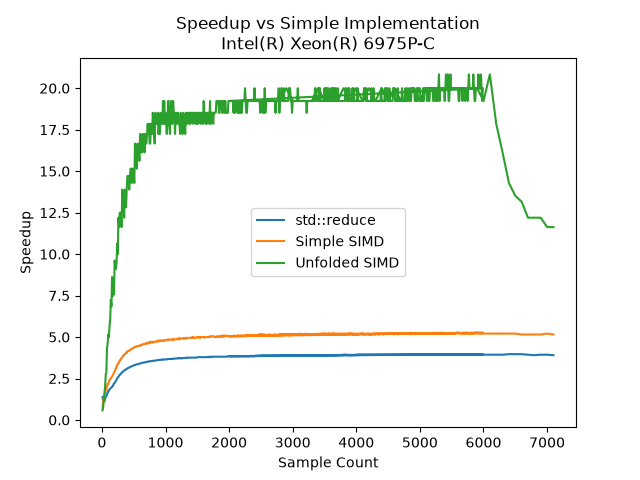
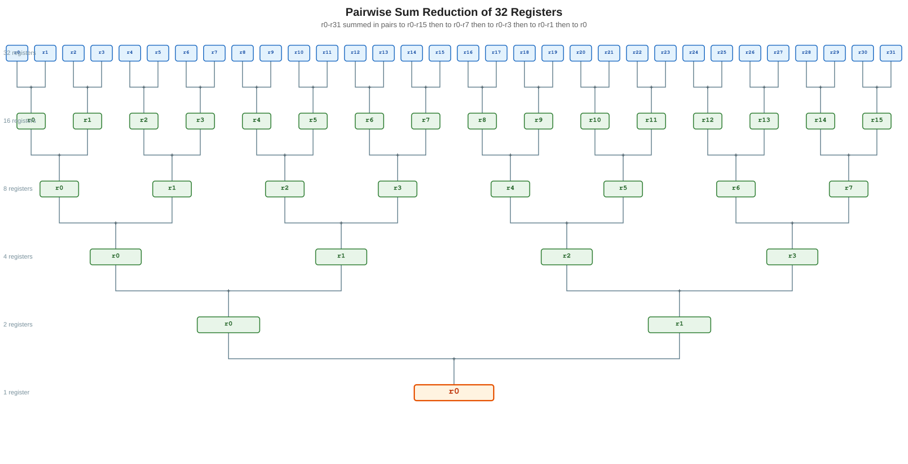
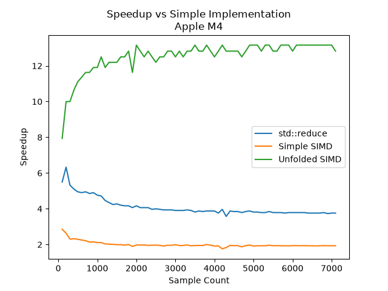
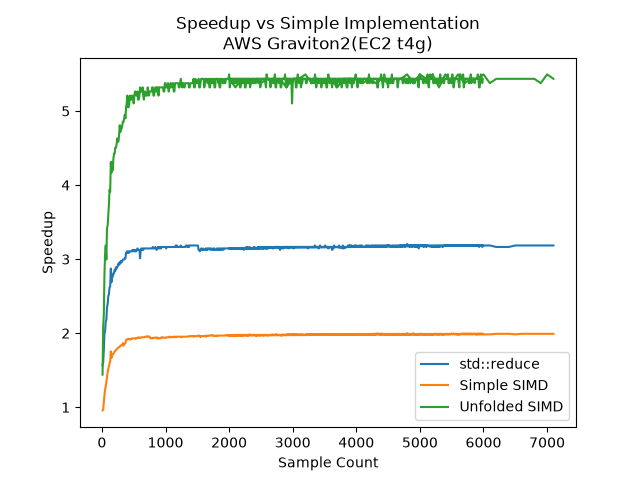
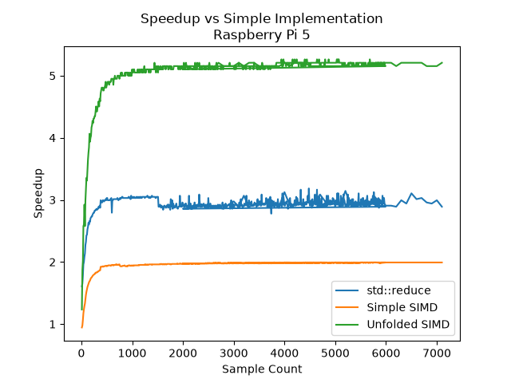

# Overview

Experiments with leveraging AVX-512 and NEON for vectorized
([SIMD](https://en.wikipedia.org/wiki/Single_instruction,_multiple_data))
reduction operations, using python for code generation.

In this example we produce a vector reduction function that can be used with
AVX-512 and NEON.

With proper coding techniques we can achieve performances of 20x
for double precision floating point data with Xeon processors.





(Graphic courtesy of https://grok.com)

In the case of AVX-512, each register is 64 bytes in size. So each
add is adding 8 doubles at once or 16 floats. By using multiple
registers, we can take advantage of the parallelism of the CPU
where available.

# Usage

```c++
type vector_reduce(const type *data, size_t size) ;
```

Where type may be an int32_t, int64_, float, or double.

# Experimental gcc simd support

GCC has some experimental support for SIMD vectorization. Interesting just
a simple reduction loop Consistently under performs the intrinsics 32x
unfolded version. This is probably due to the stdx::reduce
expanding out to fairly large block if instructions to extract
the vector to individual elements and the compiler, even with optimization
will not use parallel registers for the reduction.

When we apply the same pattern of using multiple variables (registers) to the
experimental simd code we recover the performance on par with the
intrinsics version.

## 32 Variables unfolded.

32 was chosen (though it can be rendered to more or less with the option
supplied in the python code). Since both AVX and NEON have 32 registers.
However, in both
the intrinsics implementation and the experimental simd implementation, we are
only using 16 registers. This is because
the reduction code is compiled with `-mavx512f` and `-mavx512vl`, which enables
the use of AVX-512 instructions,
The compiler only uses 16 when we look at the compiled assembly code at the -O3
level.

## _CAUTION_ Byte Alignment

In order to use this code with AVX-512, the input data must be byte aligned to a
64 byte boundary. This means that the address of the data must be a multiple of
64
bytes. This is because AVX-512 uses 512-bit
registers, which are 64 bytes in size. If the data is not byte aligned, the code
will fault.

16-byte boundaries are highly recommended for NEON.

### With C++ and Boost [Aligned Allocator](https://www.boost.org/doc/libs/latest/doc/html/align/reference.html#align.reference.classes.aligned_allocator)

```c++
#include <boost/align/aligned_allocator.hpp>
typedef double target_type ;
typedef std::vector<target_type, boost::alignment::aligned_allocator<target_type, 64>> vector_aligned64_t;
```

### With POSIX

```C
#include <stdlib.h>
int posix_memalign(void **memptr, size_t alignment, size_t size);
```

# Applications

Numeric algorithms that need a reduction operation, where
this can be used to accelerate the computation without the
need for a dedicated GPU.

The threshold for the need of a GPU can be raised here since
the upload/download penalty to GPU memory can be avoided.

More generally we're providing an example of how to use vector
processors with C/C++ but maintaining an awareness that we can't
rely solely on the compiler flags (-O3 with -march=native) alone
to provide peak performance.

# Benchmarking

## Standard

Benchmarks are evaluated against the simplest reduction implementation:

```c++
template<typename T>
T generic_reduction(T *src, size_t len, T initial)
{
    for(size_t i = 0; i < len; i++)
    {
        initial += src[i];
    }
    return initial;
}
```

With Double precision floating point (64-bit)

| Platform                 | approx Speedup vs simple loop |
|--------------------------|-------------------------------|
| std::reduce              | 4x                            |
| Apple M4                 | 13x                           |
| Xeon(R) 6975P-C(EC2 c8i) | 20x                           |
| AWS Graviton2(EC2 t4g)   | 5x                            |
| Raspbery Pi 5b           | 5x                            |

The performance of the M4 was something of a surprise.
The NEON vector registers only hold 2 double, where as
the AVX2 vector registers hold 8 doubles.





# Setup Ubuntu

## Gtest

```bash
git clone https://github.com/google/googletest.git
cd googletest
git checkout v1.18.0
mkdir build
cd build
cmake -DCMAKE_BUILD_TYPE=Release ..
make -j `nproc`
sudo make install
```

## Boost

```bash
sudo apt install libboost-program-options-dev libboost-timer-dev
```

## gcc-16

```bash
sudo add-apt-repository ppa:ubuntu-toolchain-r/test
sudo apt update
sudo apt install gcc-16 g++-16
sudo update-alternatives --install /usr/bin/gcc gcc /usr/bin/gcc-13 13 
sudo update-alternatives --install /usr/bin/gcc gcc /usr/bin/gcc-16 16
# Select GCC 16 as the default
sudo update-alternatives --config gcc
```

## Python

# Setup amazon Linux

```bash
sudo dnf groupinstall "Desktop" -y
sudo dnf install python3.14 gcc-c++ git cmake boost-devel gtest-devel
sudo python3.14 -m pip install jinja2
```

# Setup Ubuntu

```bash
cd python
virtualenv -p python3 .venv
source .venv/bin/activate
pip install -r requirements.txt
python vector_gen.py -v
```

# Benchmarking

Benchmarking is done by comparing the performance of a given
implementation against a simple summation loop:

```c++
T genericSum(T *src, size_t len, T initial)
{
    for(size_t i = 0; i < len; i++)
    {
        initial += src[i];
    }
    return initial;
}
```

## Approaches

### std::reduce

This is the c++ standard library implementation of a reduction loop.
We can see get consistant 4x performance improvement over the simple summation
loop.

### GCC Compiler Intrinsics

GCC provides access to advanced CPU functions
via [intrinsic functions](https://gcc.gnu.org/onlinedocs/gcc/x86-Built-in-Functions.html).
However, intrinsics differ between CPU types, making portability difficult,
though not impossible. There is often overlap in instruction functionality (i.e.
there are intrinsic instructions in one
CPU type that have analogs
in different CPU type e.g., load a register).

It's here that we do some unrolling of the loops. We use 32 entries,
representing the 32 vector register available in both AVX-512 and NEON.
This allows the compiler's optimizer to perform more aggressive optimizations,
taking advantage of parallelism available in the CPU. In our 'optimal'
sample size ranges (in about the 2000-7000 sample) range, we see
performance as high as a 20x improvement over the simple loop and a
5x improvement over std::reduce

When we apply the same unrolling the std::experimental::native_simd
we see the same improvement.

The [python/intrinsics.jinja2](python/intrinsics.jinja2) file provides
a template that will implement common operations between an x86 AVX-512
vector processor and a Arm NEON processor, with one differnce seen
in the final reduction of the last add.

### Experimental SIMD

GCC provides access to vectorized types through the std::experimental
namespace using the native_simd type. For AVX-512 this allows the
use of the 512-bit vector register and in NEON the native_simd type
provides a 128-bit vector register.

These provide the advantage over intrinsics in that
the [unrolled c++ code](lib/vector_reduce_simd.cpp) is portable
between AVX-512, NEON types and other types supported by
[std::experimental::native_simd](https://cppreference.com/cpp/experimental/simd/simd).

This also allows the use
of [C++ templates](https://en.cppreference.com/cpp/language/templates) to
implement a generic reduction
operation that can be used for various numeric types. Explicit
instantiation is used to generate the code for the various types, avoiding
code bloat from template expansion.

```c++
template<typename T>
using vector_t = std::experimental::native_simd<T>;
```

When we use these in our simple summation loop:

```c++
template<typename T>
T vector_reduce_simple_simd(T *src, size_t len, T initial)
{
    typedef stdx::native_simd<T> vector_t ;
    vector_t r, vinitial(0) ;
    size_t n = len / vector_t::size() ;
    for ( size_t i = 0 ; i < n ; i++ )
    {
        r.copy_from(src, stdx::vector_aligned);
        vinitial += r;
        len -= vector_t::size();
        src += vector_t::size();
    }
    initial += stdx::reduce(vinitial) ;
    for( size_t i = 0 ; i < len % vector_t::size() ; i++, src++ ) {
        initial += *src ;
    }
    return initial;
}
```

We can see about a 5x improvement over the simple summation loop.
However, there is much more improvement to be had.

### C++ Template Varargs reduction

Here we apply C++ templates, using recursion with a template's variable
arguments:

```c++
template<typename T>
using vector_t = std::experimental::native_simd<T>;

template<typename T>
inline static vector_t<T> reduce(vector_t<T> a, T *srcB) // terminal case for recursion
{
    vector_t<T> b ;
    b.copy_from(srcB, stdx::vector_aligned);
    return a + b ;
}

inline static auto reduce(auto a, auto srcB, auto... args) // consume argument and recurse
{
    return reduce(reduce(a, srcB), args...) ;
}

template<typename T>
inline static vector_t<T> reduce(vector_t<T> a, T *srcB) // terminal case for recursion
{
    vector_t<T> b ;
    b.copy_from(srcB, stdx::vector_aligned);
    return a + b ;
}

inline static auto reduce(auto a, auto srcB, auto... args) // consume argument and recurse
{
    return reduce(reduce(a, srcB), args...) ;
}

template<typename T>
T va_reduce_simd(T *src, size_t len, T initial)
{
    const auto sz = vector_t<T>::size() ;
    vector_t<T> vinitial ;
    /*
     *
     */
    vinitial = 0 ;
    while( len >= 32*sz ) {
        vinitial += reduce(vector_t<T>(0), &src[0*sz], &src[1*sz], &src[2*sz], &src[3*sz], &src[4*sz], &src[5*sz], &src[6*sz], &src[7*sz], &src[8*sz], &src[9*sz], &src[10*sz], &src[11*sz], &src[12*sz], &src[13*sz], &src[14*sz], &src[15*sz], &src[16*sz], &src[17*sz], &src[18*sz], &src[19*sz], &src[20*sz], &src[21*sz], &src[22*sz], &src[23*sz], &src[24*sz], &src[25*sz], &src[26*sz], &src[27*sz], &src[28*sz], &src[29*sz], &src[30*sz], &src[31*sz]) ;
        len -= 32*sz ;
        src += 32*sz ;
    } // while

    initial += stdx::reduce(vinitial) ;
    return initial ;
}
```

This produces comparable speed up to both the intrinsics and other simd
implementations. If it could be said there's a distinct advantage
of this approach, is that it reduces the reduction operation to
a single load and single add. The 'unrolling' is accomplished
by invoking the head template for 32 values, and letting the
compiler's optimizer go to work with the inlined expansions.

# Takeaways

There is significant computational capability in both AVX-512 and NEON
vector processors. However, accessing it via the compiler flags (-O3 with
-march=native) alone is not sufficient.

The performance of any implementation starts to drop off around
200,000 samples (1.6MB of double precision floating point) and begins
to converge around 300,000 samples. We're running up against
cache sizes and paging tables at this point with our simple
implementations and unfolded SIMD operations incurring
the same penalties.

# Files

| File/dir         | Description                                                   |
|------------------|---------------------------------------------------------------|
| lib              | separate library files, may be used for other projects        |
| data             | data from benchmarking runs                                   |
| imgs             | images used in the README                                     |
| python           | python code for code generation                               |  
| benchmark.cpp    | benchmark code for performance testing                        | 
| unittests.cpp    | unit tests for the library                                    | 
| redux.cpp        | main file for benchmarking and testing                        |
| samplecounts.cpp | sample counts for benchmarking highlighting zones of interest |

# Python Templating

The more interesting part could be the Python code. Here we use
a [jinja2](https://jinja.palletsprojects.com/en/stable/)
to render the code. The compiler intrinsics for both AVX and NEON
are nearly identical in function, allowing us to recycle
the template.

This is especially useful when an algorithm appears as a pattern,
albeit a lengthy one. Using templates to render the code,
the conversion from AVX intrinsics to NEON is almost trivial. This technique
proved to useful even with stdx::experimental::simd, where the compiler is doing
the heavy lifting of
vectorization.

This would especially be useful if other operations were added such as scaling
or masking.

# Notes

## Intrinsics vs Inline Assembly

Using pure intrinsics in both AVX and NEON appears to produce better results
than using inline assembly. This is probably due to compilers at higher
optimization
levels being able to better schedule instructions and manage registers than a
human can.

## Register Usage

The rendering code can use all 32 of the AVX registers, but the reduction code
can only use 16 of them. This is because
the reduction code is compiled with `-mavx512f` and `-mavx512vl`, which enables
the use of AVX-512 instructions, but
also limits the number of registers available for use. Keeping the expansion to
32 registers or even
higher would allow for the code to adapt naturally to future processors with
higher parallelization.

## Unroll pragma

```C
#pragma GCC unroll 16
```

Produced no discernable performance improvement.  
Using multiple registers/variables enforces the breaking
the compiler's inferred dependency on interim
results.

## reduce int16 (courtesy of gemini)

If there's need to reduce a 512-bit vector of int16_t, we can use the following
code. This is a tree reduction that reduces the 512-bit vector to a single
int16_t value.

```C
#include <immintrin.h>

int16_t reduce_add_epi16_tree(__m512i v) {
    // 512-bit to 256-bit
    __m256i low256  = _mm512_castsi512_si256(v);
    __m256i high256 = _mm512_extracti64x4_epi64(v, 1);
    __m256i sum256  = _mm256_add_epi16(low256, high256);

    // 256-bit to 128-bit
    __m128i low128  = _mm256_castsi256_si128(sum256);
    __m128i high128 = _mm256_extracti128_si128(sum256, 1);
    __m128i sum128  = _mm128_add_epi16(low128, high128);

    // 128-bit shift-and-add tree
    sum128 = _mm_add_epi16(sum128, _mm_srli_si128(sum128, 8)); // shift 64 bits
    sum128 = _mm_add_epi16(sum128, _mm_srli_si128(sum128, 4)); // shift 32 bits
    sum128 = _mm_add_epi16(sum128, _mm_srli_si128(sum128, 2)); // shift 16 bits

    return (int16_t)_mm_cvtsi128_si32(sum128);
}
```
